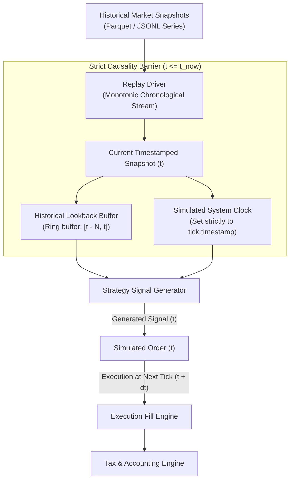

> [!CAUTION]
> **SCOPE UPDATE: BACKTESTING ENGINE RETIRED FROM ACTIVE ARCHITECTURE**
> Per the Revised Master Implementation directive, the backtesting engine, historical candle replay, and parameter sweep infrastructure have been completely removed from the active application architecture.
> The application focuses strictly on **live market data processing, independent strategy execution, advanced risk management, multi-leg position tracking, trade logging, and paper trading**.
> This document is retained for historical research reference only and does not represent an active software component.

# Backtesting & Empirical Validation Framework

**Document ID:** `BACKTEST-SPEC-2026-001`  
**Location:** `docs/strategy_research_design/backtesting_and_validation.md`  
**Classification:** Historical Research Reference (Backtesting Removed from Active Scope)  

---

## 1. Architectural Mission

A quantitative trading strategy is only as credible as its validation protocol. Most retail algorithmic strategies that exhibit stellar backtested performance fail catastrophically in live trading due to subtle biases:
- **Look-Ahead Bias**: Inadvertently utilizing future price bars, future session high/lows, or closing prices during signal evaluation.
- **Survivorship Bias**: Backtesting only against currently active option strikes or index constituents while ignoring expired or illiquid contracts.
- **Unrealistic Fill Assumptions**: Assuming limit orders fill instantaneously at exact mid-prices without bid-ask crossing, queue latency, or volume participation limits.
- **Overfitting & Data Snooping**: Tuning parameter grids until an over-parameterized curve fits historical noise rather than genuine statistical edge.

The **Backtesting and Validation Engine (`src/core/backtest_driver.py`)** enforces deterministic, bias-free simulation standards that mirror the exact runtime environment of prospective paper trading.

---

## 2. Replay Engine Architecture & Look-Ahead Prevention



### Causality Barrier Rules
1. **Monotonic Event Queue**: Historical snapshots are ingested sequentially by strictly increasing exchange timestamps.
2. **Next-Tick Execution Guarantee**: A strategy signal generated at timestamp $t$ cannot execute at the price of timestamp $t$. Simulated fills occur at the earliest at $t + \Delta t$ (the opening or ask price of the subsequent tick) to account for calculation latency and network transit.
3. **No Retrospective Bar Querying**: When evaluating 5-minute or 15-minute bar conditions, a bar is only visible to strategy logic after its official close. For example, the 09:15:00–09:20:00 bar cannot be queried until the 09:20:00 tick arrives.

---

## 3. Realistic Fill Simulation & Market Friction Models

Backtests that assume zero friction or mid-price fills produce fictitious results. The v2.0 simulation engine implements three rigorous execution friction models:

### 3.1 Bid-Ask Spread Crossing
Simulated market orders cross the full book:
- **Simulated Buy Orders**: Fill at the current **Best Ask** price (or $\text{LTP} + \frac{1}{2} \text{Spread}$).
- **Simulated Sell Orders**: Fill at the current **Best Bid** price (or $\text{LTP} - \frac{1}{2} \text{Spread}$).

### 3.2 Slippage Modeling
The paper broker provides three selectable slippage profiles:
1. **Fixed Points Slippage**:
   - Liquid Near-the-Money Options: 0.50 points per lot.
   - NIFTY Index Futures: 1.00 index points per lot.
2. **Spread-Scaled Slippage**:
   $$\text{Fill Price} = \text{LTP} \pm \left( \frac{\text{Ask} - \text{Bid}}{2} + \alpha \cdot \text{Spread} \right)$$
   Where $\alpha \in [0.1, 0.3]$ models adverse selection.
3. **Volatility-Adaptive Slippage**:
   Slippage scales dynamically with India VIX and current 1-minute ATR:
   $$\text{Slippage}_{\text{pts}} = \text{Base} \times \left(1.0 + \frac{\text{VIX} - 12.0}{10.0}\right)$$

### 3.3 Liquidity & Participation Rate Caps
- **Volume Participation Limit**: A simulated order cannot fill a quantity exceeding **5% of the total traded volume** of that instrument during that 1-minute window.
- **Open Interest Cap**: Maximum allowable simulated position per variant cannot exceed **1.0% of the instrument's open interest**.
- **Unfillable Orders**: If volume is zero or bid-ask spread exceeds 5% of LTP, the order is tagged `REJECTED_ILLIQUID`.

---

## 4. Multi-Partition Validation Protocol

To guard against overfitting, all strategy research must undergo a three-stage validation partition before being eligible for prospective paper trading:

```
[========================== TOTAL HISTORICAL DATASET ==========================]
                                       │
        ┌──────────────────────────────┼──────────────────────────────┐
        ▼                              ▼                              ▼
 [ IN-SAMPLE (TRAIN) ]      [ OUT-OF-SAMPLE (VAL) ]       [ HOLDOUT (TEST) ]
      60% of Data                 20% of Data                20% of Data
   - Hypothesis Testing       - Parameter Selection      - Final Unseen Blind Test
   - Feature Exploration      - Walk-Forward Windows     - Overfitting Verification
   - Initial Calibration      - Overfit Detection        - Zero Parameter Adjustments
```

### Partitioning Guidelines
1. **Strict Temporal Splitting**: Partitions are split chronologically (e.g., Year 1 & 2 for Train, Year 3 for Validation, Year 4 for Holdout). Random k-fold cross-validation is strictly prohibited due to temporal autocorrelation in market time-series.
2. **Purged Walk-Forward Optimization (WFO)**:
   - Rolling 6-month in-sample training window followed by a 2-month out-of-sample forward test.
   - Step forward by 2 months and repeat.
   - The strategy must demonstrate positive net expectancy across a minimum of **80% of rolling out-of-sample windows**.

---

## 5. Statistical Overfitting Tests

Before declaring any strategy variant statistically viable, the following tests must be performed:

### 5.1 Monte Carlo Trade Sequence Permutation
- Take the sequence of $N$ closed trades generated by the backtest.
- Run $M = 10,000$ Monte Carlo iterations by randomly shuffling the trade order with replacement.
- Compute the empirical distribution of **Maximum Drawdown** and **Consecutive Losses**.
- **Pass Hurdle**: The strategy's observed historical maximum drawdown must fall within the 95th percentile of the Monte Carlo drawdown distribution ($p \le 0.05$).

### 5.2 Parameter Sensitivity Analysis (Cliff Detection)
- Vary strategy parameters (e.g. SL percentage: $20\%, 22.5\%, 25\%, 27.5\%, 30\%$; entry time: $\pm 5\text{ mins}$).
- Plot the 3D performance surface.
- **Pass Hurdle**: The surface must be smooth and plate-like. If performance collapses sharply on an adjacent parameter step ("performance cliff"), the variant is rejected as an overfit anomaly.

### 5.3 Deflated Sharpe Ratio (DSR)
- When testing multiple variants ($K$ variants tested), calculate the Deflated Sharpe Ratio to correct for selection bias:
  $$\text{DSR} = f(\text{SR}, K, \text{Skewness}, \text{Kurtosis}, \text{Sample Length})$$
- **Pass Hurdle**: $\text{DSR} > 0.95$ (statistically significant edge after adjusting for the number of tested trials).

---

## 6. Data Hygiene & Edge-Case Handling

| Edge Case | Problem Description | Standard Resolution Protocol |
| :--- | :--- | :--- |
| **Contract Expiry Roll-over** | Weekly options expire every Thursday. Price series terminates at 15:30:00. | Contract database switches to the next active weekly expiry contract at 15:30:00 precisely. Old contract records close. |
| **Strike Distance Changes** | Market moves 500 points; original ATM strike is now deep in-the-money. | Dynamic strike selector queries the current spot at entry time to recalculate the fresh ATM/OTM strikes. |
| **Missing Historical Bars** | Network drops or exchange feed freeze creating missing timestamps. | Replay engine detects timestamp gap ($\Delta t > 60\text{s}$), skips missing interval, logs warning, and does NOT generate synthetic interpolated prices. |
| **Exchange Holidays** | Trading days with unexpected closures or truncated sessions (Muhurat trading). | Calendar provider filters non-trading dates using official NSE holiday schedules. |
| **NSE Lot Size Revisions** | NIFTY lot size historically transitioned from 50 to 75, then to 25. | Instrument master maps lot size dynamically to the specific historical date range of the backtest. |
