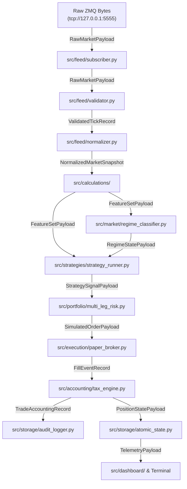

# System Data Contracts & Component Interface Specifications

**Document ID:** `DATA-CONTRACT-2026-001`  
**Location:** `docs/strategy_research_design/data_contracts.md`  
**Classification:** Inter-Module Interface Specifications & Type Signatures  
**Status:** PROPOSED ARCHITECTURAL DATA SPECIFICATION  

---

## 1. Architectural Principles of Data Contracts

In the modular v2.0 architecture, every system component interacts strictly through strongly typed, versioned data contracts. This guarantees:
1. **Zero Broker Coupling**: Contracts contain zero broker-specific identifiers (Angel One, Zerodha, Dhan). The core engine evaluates market reality, not broker API formats.
2. **Deterministic Reproducibility**: Identical data contracts are passed through both historical backtesting and live paper trading.
3. **Data Hygiene & Error Resilience**: Contracts enforce strict boundary validation, timestamp alignment, and graceful handling of degraded data (missing strikes, stale ticks, wide spreads).

---

## 2. Component Pipeline & Contract Topology



---

## 3. Formal Data Contract Specifications

### 3.1 Raw Ingestion Contract (`RawMarketPayload`)
Emitted by `src/feed/subscriber.py` upon receiving a ZeroMQ multipart frame (`topic: b"NIFTY_MARKET_TICK"`).

```python
{
    "timestamp_epoch_ms": 1735118400123,      # System receipt time
    "topic": "NIFTY_MARKET_TICK",
    "raw_tokens_count": 92,
    "feed_source_timestamp": "2026-10-25 09:20:00.100",
    "payload_dict": { ... }                   # Unvalidated dictionary from ZMQ
}
```

### 3.2 Validated Tick Record (`ValidatedTickRecord`)
Produced by `src/feed/validator.py`. Verifies timestamp freshness, type safety, and value bounds.

```python
@dataclass(frozen=True)
class OptionStrikeQuote:
    token: str
    strike_price: float
    option_type: str                  # "CE" | "PE"
    ltp: float                        # Last Traded Price (> 0.0)
    bid: float                        # Best Bid
    ask: float                        # Best Ask
    volume: int                       # Cumulative Day Volume
    open_interest: int                # Current Open Interest
    delta: float                      # Black-Scholes Delta (-1.0 to 1.0)
    gamma: float                      # Gamma (>= 0.0)
    theta: float                      # Theta (< 0.0)
    vega: float                       # Vega (>= 0.0)
    iv: float                         # Implied Volatility (0.05 to 2.50)

@dataclass(frozen=True)
class ValidatedTickRecord:
    exchange_timestamp: str           # "YYYY-MM-DD HH:MM:SS.mmm" IST
    sequence_id: int
    nifty_spot_ltp: float             # e.g. 24852.30
    nifty_futures_ltp: float          # e.g. 24895.10
    india_vix: float                  # e.g. 13.85
    option_chain: Dict[str, OptionStrikeQuote] # Key: "25000_CE", "25000_PE"
    validation_status: str            # "VALID" | "DEGRADED" | "CORRUPTED"
```

### 3.3 Derived Features Contract (`FeatureSetPayload`)
Produced by `src/calculations/` containing normalized market indicators.

```python
@dataclass(frozen=True)
class FeatureSetPayload:
    timestamp: str
    spot: float
    futures: float
    atm_strike: int                   # round(spot / 50.0) * 50
    futures_basis: float              # futures - spot
    futures_basis_pct: float          # basis / spot * 100
    atm_straddle_combined_ltp: float  # atm_ce_ltp + atm_pe_ltp
    atm_straddle_decay_pct: float     # Intraday premium decay from 09:20 open
    intraday_vwap: float              # Volume Weighted Average Price
    fast_ema_9: float
    slow_ema_21: float
    ema_slope_9: float                # d(EMA9)/dt
    atr_14: float
    pcr_oi: float                     # Total PE OI / Total CE OI
    pcr_volume: float                 # Total PE Volume / Total CE Volume
    iv_skew_spread: float             # PE_IV - CE_IV at ATM
```

### 3.4 Market Regime State (`RegimeStatePayload`)
Produced by `src/market/regime_classifier.py`.

```python
@dataclass(frozen=True)
class RegimeStatePayload:
    timestamp: str
    primary_regime: str               # e.g. "SIDEWAYS_RANGE_BOUND"
    secondary_regime: str             # e.g. "LOW_VOLATILITY"
    structural_context: str           # e.g. "ORB_INSIDE_RANGE"
    temporal_context: str             # e.g. "STANDARD_SESSION" | "EXPIRY_0DTE"
    confidence_score: float           # 0.00 to 1.00
    is_degraded: bool                 # True if market data inputs are incomplete
```

### 3.5 Strategy Signal Contract (`StrategySignalPayload`)
Produced by `src/strategies/strategy_runner.py`.

```python
@dataclass(frozen=True)
class SignalLeg:
    leg_id: str
    instrument: str                   # "NIFTY26OCT24800CE"
    side: str                         # "BUY" | "SELL"
    order_type: str                   # "MARKET" | "LIMIT"
    suggested_limit_price: float      # Required for LIMIT orders
    quantity: int                     # e.g. 75

@dataclass(frozen=True)
class StrategySignalPayload:
    signal_id: str                    # Unique UUID
    strategy_id: str                  # e.g. "CORE_005"
    variant_id: str                   # e.g. "VAR_STRADDLE_0920_SL25_TSL5"
    timestamp: str
    action: str                       # "OPEN_LONG" | "OPEN_SHORT" | "CLOSE_SL" | "CLOSE_TP" | "SQUARE_OFF"
    legs: List[SignalLeg]
    initial_sl_type: str
    initial_sl_value: float
    profit_target_value: float
    tsl_type: str
    tsl_trigger: float
    tsl_step: float
    regime_at_signal: str
    confidence_score: float
```

### 3.6 Simulated Order & Execution Fill (`SimulatedOrderPayload` & `FillEventRecord`)
Produced by `src/portfolio/` and `src/execution/paper_broker.py`.

```python
@dataclass(frozen=True)
class SimulatedOrderPayload:
    order_id: str
    signal_id: str
    variant_id: str
    leg_id: str
    symbol: str
    side: str                         # "BUY" | "SELL"
    order_type: str                   # "MARKET"
    quantity: int
    requested_price: float
    timestamp: str

@dataclass(frozen=True)
class FillEventRecord:
    fill_id: str
    order_id: str
    variant_id: str
    leg_id: str
    symbol: str
    side: str
    quantity: int
    requested_price: float
    fill_price: float                 # Price after modeled slippage
    slippage_points: float            # fill_price - requested_price
    slippage_cost_inr: float
    fill_timestamp: str
    status: str                       # "FILLED" | "REJECTED_LIQUIDITY" | "REJECTED_CIRCUIT"
```

### 3.7 Trade Accounting Record (`TradeAccountingRecord`)
Produced by `src/accounting/tax_engine.py`. Computes statutory taxes and gross/net P&L per trade.

```python
@dataclass(frozen=True)
class TradeAccountingRecord:
    trade_id: str
    variant_id: str
    strategy_id: str
    instrument: str
    side: str
    entry_time: str
    exit_time: str
    entry_price: float
    exit_price: float
    quantity: int
    turnover: float                   # (entry_price + exit_price) * quantity
    gross_pnl: float                  # Pre-tax P&L
    brokerage: float                  # ₹20 flat per order (₹40 round-trip)
    stt: float                        # Securities Transaction Tax (Sell side only)
    exchange_charges: float           # NSE turnover fee
    gst: float                        # 18% on (Brokerage + Exchange Charges)
    sebi_charges: float               # SEBI turnover charge
    stamp_duty: float                 # Stamp duty (Buy side only)
    total_tax_and_charges: float      # Sum of all statutory fees
    net_pnl: float                    # gross_pnl - total_tax_and_charges
    exit_reason: str                  # "SL" | "TP" | "TSL" | "EOD_SQUAREOFF"
```

---

## 4. Degraded Data Handling & Boundary Policies

| Anomaly Condition | Detection Rule | Engine Action & Boundary Policy |
| :--- | :--- | :--- |
| **Missing Ticks** | Latency between ticks > 3.0s | Flag feed as `STALE`. Suppress all new strategy entries. Active positions continue stop-loss monitoring using last valid price. |
| **Wide Bid-Ask Spread** | $\text{Ask} - \text{Bid} > 5.0\%$ of LTP | Reject simulated market order fills. Classify as `REJECTED_LIQUIDITY` to avoid unrealistic simulated pricing. |
| **Incomplete Option Chain** | Required delta/strike token missing from feed snapshot | Refuse trade entry. Log warning to `logs/errors/feed_errors.log`. Do not substitute an arbitrary strike. |
| **Circuit Breakers / Halt** | NIFTY spot halts or tick volume drops to zero during session | Emergency freeze: In-memory position trackers lock; automatic trading halted until market resumes. |
| **Pre/Post-Market Ticks** | Tick timestamp outside `09:15:00` to `15:30:00` IST | Discard ticks immediately at validator layer. Zero strategy handlers are invoked. |
| **Stale Quote Freeze** | Instrument LTP unchanged while spot moves > 50 points | Suppress option buying signals on the frozen token; flag strike quote as `FROZEN_LIQUIDITY`. |

---

## 5. Persistence Contracts & Telemetry Schema

### 5.1 Audit Trail (`logs/trades/trades_VAR_*.csv`)
Every variant writes to an auditable 19-column CSV ledger matching the canonical schema:
1. `Timestamp`: ISO-8601 string (`YYYY-MM-DD HH:MM:SS`)
2. `Strategy_ID`: e.g. `CORE_005`
3. `Variant_ID`: e.g. `VAR_STRADDLE_0920_SL25_TSL5`
4. `Instrument`: e.g. `NIFTY26OCT24800CE`
5. `Side`: `BUY` or `SELL`
6. `Qty`: e.g. `75`
7. `Entry_Price`: e.g. `142.50`
8. `Exit_Price`: e.g. `106.85`
9. `Gross_PnL`: e.g. `+2673.75`
10. `Brokerage`: e.g. `40.00`
11. `STT`: e.g. `10.69`
12. `Exchange_Charges`: e.g. `9.35`
13. `GST`: e.g. `8.88`
14. `SEBI_Charges`: e.g. `0.02`
15. `Stamp_Duty`: e.g. `0.32`
16. `Total_Taxes`: e.g. `69.26`
17. `Net_PnL`: e.g. `+2604.49`
18. `Exit_Reason`: e.g. `PROFIT_TARGET`
19. `Regime_Tag`: e.g. `SIDEWAYS_RANGE_BOUND`

### 5.2 Live Telemetry Snapshot (`logs/live_state.json`)
Atomic telemetry payload serialized every 1.0 second:

```json
{
  "engine_status": "ONLINE_PAPER_TRADING",
  "last_tick_time": "15:14:59.850",
  "spot_price": 24850.25,
  "futures_price": 24892.10,
  "india_vix": 13.45,
  "active_regime": {
    "primary": "SIDEWAYS_RANGE_BOUND",
    "volatility": "LOW_VOLATILITY",
    "confidence": 0.82
  },
  "portfolio_summary": {
    "total_variants_active": 15,
    "total_open_legs": 4,
    "unrealized_mtm": 1420.50,
    "realized_gross_pnl": 5840.00,
    "total_taxes_paid": 482.10,
    "realized_net_pnl": 5357.90
  },
  "active_positions": [ ... ]
}
```
