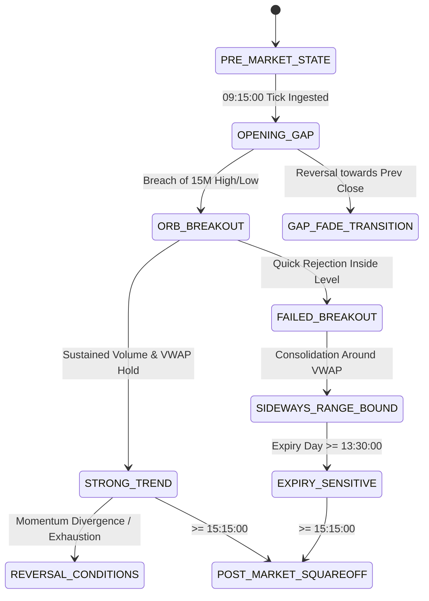

# Market Regime Classification Specification

**Document ID:** `REGIME-SPEC-2026-001`  
**Location:** `docs/strategy_research_design/market_regime_specification.md`  
**Classification:** Analytical Systems Specification & Quantitative Taxonomy  
**Status:** PROPOSED RESEARCH SPECIFICATION (All Thresholds Subject to Empirical Validation)  

---

## 1. Executive Mission & Quantitative Philosophy

Financial markets do not operate under stationary statistical distributions. Quantitative strategies that excel during persistent directional trends frequently incur catastrophic losses during range-bound chop, while premium-selling strategies that flourish in low-volatility compression suffer outsized drawdowns during volatility expansion.

The **Market Regime Classification Engine (`src/market/regime_classifier.py`)** provides real-time, timestamped environmental awareness to the Multi-Strategy Bot. Its primary responsibilities are:
1. **Multi-Dimensional State Mapping**: Measuring market conditions across four distinct, orthogonal dimensions:
   - **Directional Trend** (Bullish, Bearish, Neutral)
   - **Volatility State** (High Volatility Expansion, Low Volatility Compression, Normal)
   - **Structural / Auction Stage** (Opening Gap, Opening Range Breakout, Mean Reverting, Structural Failure)
   - **Temporal / Event Context** (Standard Session, Expiry Day 0-DTE, Macro Event)
2. **Dynamic Intraday Transitions**: Evaluating market state continuously across rolling time intervals rather than assuming a static classification for the entire day.
3. **Strategy Eligibility Gating**: Enabling strategies to declare explicit regime filters (e.g., Short Straddles active only during `SIDEWAYS_RANGE_BOUND` and `LOW_VOLATILITY`).
4. **Attribution & Diagnostics**: Tagging every simulated order and trade event with the prevailing market regime for post-hoc performance slicing.

> [!WARNING]
> **Research Threshold Rule**:
> In strict accordance with the quantitative governance guidelines, **all numerical parameter thresholds specified in this document are proposed research parameters requiring empirical validation**. They must never be treated as hardcoded financial truths.

---

## 2. Multi-Dimensional Regime Taxonomy

A market state at any timestamp $t$ is expressed as a composite vector across four independent dimensions:

$$\vec{R}_t = \langle \text{Trend}_t, \text{Volatility}_t, \text{Structure}_t, \text{Context}_t \rangle$$

```
                         [ MARKET REGIME VECTOR ]
                                     │
         ┌───────────────────┬───────┴───────────┬──────────────────┐
         ▼                   ▼                   ▼                  ▼
   [ DIRECTION ]      [ VOLATILITY ]      [ STRUCTURE ]       [ CONTEXT ]
  - Bullish Trend    - High Volatility   - Opening Gap       - Standard
  - Bearish Trend    - Low Volatility    - Range Bound (Chop)- 0-DTE Expiry
  - Sideways/Neutral - Expanding Vol     - ORB Breakout      - Event Day
                     - Compressing Vol   - Failed Breakout   - Pre/Post Expiry
                                         - Key Level Reversal
```

---

## 3. Detailed Regime Definitions & Observable Indicators

### 3.1 Directional Trend Regimes

#### 1. `STRONG_BULLISH_TREND`
- **Concept**: Sustained upward price discovery with aggressive institutional buying pressure.
- **Observable Observable Features**:
  - Spot price > Intraday VWAP.
  - Fast EMA ($E_9$) > Slow EMA ($E_{21}$) with positive slope ($\frac{dE}{dt} > 0$).
  - Futures basis spread positive and expanding ($\text{Futures} - \text{Spot} > \text{Basis}_{\text{mean}}$).
  - Call Open Interest unwinding + Put Open Interest addition ($\Delta \text{PE}_{\text{OI}} > \Delta \text{CE}_{\text{OI}}$).
- **Proposed Parameter Thresholds (For Validation)**:
  - $\text{Price} - \text{VWAP} \ge +0.25\%$.
  - 15-minute ADX $\ge 25.0$.
  - Put-Call Ratio (PCR) $\ge 1.15$.

#### 2. `STRONG_BEARISH_TREND`
- **Concept**: Sustained downward price discovery with active liquidation or institutional short building.
- **Observable Features**:
  - Spot price < Intraday VWAP.
  - Fast EMA ($E_9$) < Slow EMA ($E_{21}$) with negative slope.
  - Futures basis compressing or trading at a discount ($\text{Futures} < \text{Spot}$).
  - Call Open Interest heavy build-up + Put Open Interest liquidation.
- **Proposed Parameter Thresholds (For Validation)**:
  - $\text{Price} - \text{VWAP} \le -0.25\%$.
  - 15-minute ADX $\ge 25.0$.
  - Put-Call Ratio (PCR) $\le 0.80$.

#### 3. `SIDEWAYS_RANGE_BOUND`
- **Concept**: Balanced auction where buyers and sellers are in equilibrium; price oscillates within horizontal value boundaries.
- **Observable Features**:
  - Spot price repeatedly oscillating around Intraday VWAP.
  - Moving average slopes flat ($\left|\frac{dE}{dt}\right| \approx 0$).
  - NIFTY 15-minute ATR below historical intraday mean.
  - ATM straddle premium decaying predictably without directional expansion.
- **Proposed Parameter Thresholds (For Validation)**:
  - $\left|\text{Price} - \text{VWAP}\right| < 0.15\%$.
  - 15-minute ADX $< 18.0$.
  - Bollinger Band width (20, 2) in lowest 30th percentile of last 10 sessions.

---

### 3.2 Volatility Regimes

#### 4. `HIGH_VOLATILITY` (Volatility Expansion)
- **Concept**: Heightened market uncertainty, wide price swings, and rapid option repricing.
- **Observable Features**:
  - India VIX elevated or expanding sharply intraday.
  - ATM option Implied Volatility (IV) above rolling 20-day mean.
  - NIFTY 5-minute candle ranges exceeding $2.0 \times \text{ATR}_{14}$.
- **Proposed Parameter Thresholds (For Validation)**:
  - $\text{India VIX} \ge 16.5$ OR Intraday $\Delta \text{VIX} \ge +5.0\%$.
  - Current ATM IV percentile $\ge 70\%$.

#### 5. `LOW_VOLATILITY` (Volatility Compression)
- **Concept**: Subdued market activity, small realized price ranges, and steady option premium erosion.
- **Observable Features**:
  - India VIX subdued and declining intraday.
  - ATM option IV in lowest quartile.
  - Realized volatility significantly below implied volatility.
- **Proposed Parameter Thresholds (For Validation)**:
  - $\text{India VIX} \le 12.5$ AND Intraday $\Delta \text{VIX} \le 0\%$.
  - Current ATM IV percentile $\le 30\%$.

---

### 3.3 Structural & Auction Regimes

#### 6. `OPENING_GAP_UP` / `OPENING_GAP_DOWN`
- **Concept**: Discontinuity between current session open and prior session close.
- **Observable Features**:
  - Opening tick $P_{\text{open}}$ significantly separated from previous close $P_{\text{close-prev}}$.
- **Proposed Parameter Thresholds (For Validation)**:
  - Gap Up: $(P_{\text{open}} - P_{\text{close-prev}}) / P_{\text{close-prev}} \ge +0.35\%$.
  - Gap Down: $(P_{\text{open}} - P_{\text{close-prev}}) / P_{\text{close-prev}} \le -0.35\%$.

#### 7. `OPENING_RANGE_BREAKOUT` (ORB Bullish / Bearish)
- **Concept**: Price decisively penetrating and holding outside the high or low of the initial 15-minute auction range.
- **Observable Features**:
  - Spot price breaks above $H_{\text{15M}}$ or below $L_{\text{15M}}$.
  - Breakout confirmed by tick volume surge ($\text{Vol} \ge 1.5 \times \text{Vol}_{\text{avg}}$).
- **Proposed Parameter Thresholds (For Validation)**:
  - Spot holds outside range for $\ge 3$ consecutive 1-minute bars.

#### 8. `FAILED_BREAKOUT` (Liquidity Trap)
- **Concept**: Price momentarily crosses a key reference level (PDH, PDL, or ORB High/Low), fails to attract follow-through volume, and sharply re-enters the previous range.
- **Observable Features**:
  - Quick rejection wick on high volume followed by immediate reversal back inside the level.
- **Proposed Parameter Thresholds (For Validation)**:
  - Reversal back inside the broken level within $\le 5$ minutes of the breach.

#### 9. `REVERSAL_CONDITIONS`
- **Concept**: Exhaustion of a prevailing trend evidenced by momentum divergence or rejection of key structural levels (Pivots, OI walls).
- **Observable Features**:
  - New price high/low accompanied by lower indicator momentum (RSI / MACD divergence).
  - Heavy strike OI buildup rejecting price advance.
- **Proposed Parameter Thresholds (For Validation)**:
  - 14-period RSI $> 75$ with bearish divergence OR RSI $< 25$ with bullish divergence.

---

### 3.4 Temporal & Event Context Regimes

#### 10. `EXPIRY_SENSITIVE` (0-DTE Contract Expiry)
- **Concept**: Special weekly/monthly options expiration day characterized by extreme gamma sensitivity and accelerated time decay.
- **Observable Features**:
  - Exchange calendar confirms contract expires on current trading date.
  - Time elapsed past 13:00:00 IST on expiry day.
  - Straddle decay accelerates; ATM strikes exhibit high pinning tendency.
- **Proposed Parameter Thresholds (For Validation)**:
  - Date matches active contract expiry AND current time $\ge \text{13:00:00}$ IST.

#### 11. `EVENT_SENSITIVE`
- **Concept**: Trading session co-occurring with major scheduled economic or political events (Union Budget, RBI Monetary Policy, General Election Results, US CPI/Fed).
- **Observable Features**:
  - Explicit calendar flag active in event database.
  - Implied volatility inflated pre-event; sharp IV collapse post-announcement.
- **Proposed Parameter Thresholds (For Validation)**:
  - Event tag active AND time within $\pm 2$ hours of announced event window.

---

## 4. Dynamic Intraday Transition Mechanics

Regimes are **not static across a trading day**. A session that opens with `OPENING_GAP_UP` may transition to `FAILED_BREAKOUT` by 10:00 AM, settle into `SIDEWAYS_RANGE_BOUND` from 11:00 AM to 1:30 PM, and enter `EXPIRY_SENSITIVE` gamma expansion by 2:15 PM.



### Transition Smoothing & Rolling Windows
To prevent rapid flip-flopping ("regime chatter") on noisy individual ticks:
1. **Multi-Horizon Feature Evaluation**: Features are sampled across rolling timeframes:
   - **Fast Horizon (1-min)**: Used for quick breakout detection and immediate stop triggers.
   - **Medium Horizon (5-min)**: Used for trend confirmation and moving average alignment.
   - **Slow Horizon (15-min / 30-min)**: Used for structural boundaries and regime persistence.
2. **Transition Hysteresis**: A regime transition requires confirmation across $N$ consecutive evaluations ($N \ge 3$ minutes) before an active regime tag changes, unless a hard structural breach (e.g. gap break) occurs.

---

## 5. Ambiguity Resolution & Conflict Priority Matrix

When indicators provide conflicting signals (e.g., ADX indicates trend, but price is near VWAP), the classifier applies a deterministic hierarchy:

```
Priority Level 1 (Highest): TEMPORAL / EVENT CONTEXT (Expiry 0-DTE, Major Macro Event)
Priority Level 2: STRUCTURAL DISCONTINUITY (Opening Gap, Failed Breakout Trap)
Priority Level 3: VOLATILITY STATE (High Vol Expansion vs Low Vol Compression)
Priority Level 4 (Base): DIRECTIONAL TREND (Bullish vs Bearish vs Range-Bound)
```

### Confidence Scoring
The classifier computes a normalized **Regime Confidence Score** ($C_R \in [0.0, 1.0]$):

$$C_R = \sum_{i=1}^{K} w_i \cdot I_i$$

Where $I_i \in \{0, 1\}$ represents the satisfaction of rule $i$, and $w_i$ is its normalized weight.
- **High Conviction ($C_R \ge 0.75$)**: Clean, decisive conditions. Strategies execute standard sizing.
- **Moderate Conviction ($0.50 \le C_R < 0.75$)**: Partial alignment. Strategies may size down or require tighter confirmation.
- **Ambiguous ($C_R < 0.50$)**: Conflicting indicators. Default to `AMBIGUOUS_CHOP`. Directional strategies stand down.

### Fallback Behavior for Missing or Stale Data
- If ZeroMQ ticks are delayed ($> 2.5\text{s}$) or option chain strikes are incomplete, the regime classifier immediately outputs `REGIME_DEGRADED_DATA`.
- In `REGIME_DEGRADED_DATA` mode, all strategy entry signals are suppressed; existing positions maintain safety stop-loss monitoring only.
