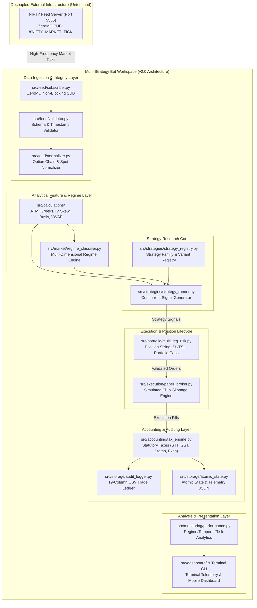
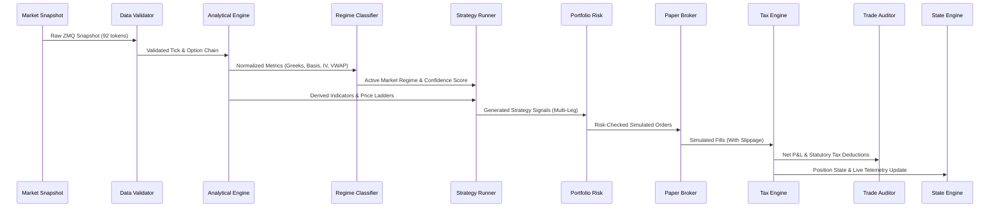

# Master Strategy Research Architecture Design

**System Name:** NIFTY Multi-Strategy Research & Simulation Platform (v2.0)  
**Document ID:** `ARCH-DOC-2026-001`  
**Location:** `docs/strategy_research_design/master_research_architecture.md`  
**Classification:** Quantitative Systems Architecture & Research Blueprint  
**Status:** PROPOSED ARCHITECTURAL SPECIFICATION (Design & Documentation Only)  

---

## 1. Architectural Mission & Clean-Slate Philosophy

Following the deliberate decommissioning and archival of the legacy single-file quantitative model (`archive/legacy_v1/`), this document specifies the complete, clean-slate design for the **NIFTY Multi-Strategy Research and Simulation Platform**.

The objective of this architecture is to provide an institutional-grade, data-driven quantitative framework capable of:
1. **Hypothesis-Driven Strategy Research**: Evaluating diverse quantitative trading concepts across options, futures, and multi-leg spreads without hardcoded biases.
2. **Multi-Variant Research Scaling**: Concurrently running and evaluating dozens of parameterized strategy variants across different timeframe, strike selection, and stop-loss rules.
3. **Dynamic Market Regime Awareness**: Contextualizing strategy performance within distinct, timestamped market conditions (trending, range-bound, high/low volatility, gap days, expiry dynamics).
4. **Day-Specific & Intraday Temporal Attribution**: Dissecting trading efficacy across trading days of the week, session phases (open, mid-day, close), and expiry horizons (0-DTE, weekly, monthly).
5. **Unified Dual-Mode Operation**: Supporting deterministic offline historical backtesting and real-time prospective paper trading using identical strategy interface logic.
6. **Statutory Transaction Accounting**: Accurately computing net yield by embedding exact Indian statutory taxation (STT, GST, stamp duty, exchange charges, SEBI fees) and slippage friction.
7. **Resource-Constrained Edge Execution**: Retaining native Python lightweight execution discipline to run seamlessly across both high-performance Windows 11 workstations and battery-efficient Android Termux edge nodes.

> [!IMPORTANT]
> **Design Boundary Notice**:
> This document provides architectural specifications, system contracts, component boundaries, and research catalogs. In strict compliance with project governance (`AGENTS.md`), **zero trading logic is implemented in this phase**, no live broker credentials exist, and no market feed sockets are opened.

---

## 2. Decoupled System Architecture & Operational Boundary

The platform operates as a strictly decoupled, independent consumer. It does not contain an embedded market data provider or live broker integration.



### System Boundaries and Separation Rules
1. **Feed Isolation**: The bot connects to `tcp://127.0.0.1:5555` purely as a read-only ZeroMQ subscriber. It never pushes data back to the feed server.
2. **Broker Isolation**: All execution occurs in simulated virtual accounts. The system contains no broker order APIs, no broker authentication secrets, and no live order routing logic.
3. **Storage Boundary**: All audit trails, telemetry files, and state caches write exclusively to `logs/` and `runtime/` inside the local workspace.

---

## 3. End-to-End Processing Pipeline

The v2.0 engine processes data across 10 deterministic, non-blocking pipeline stages:



### Pipeline Stage Breakdown

| Stage | Module Path | Input Contract | Output Contract | Latency Budget |
| :--- | :--- | :--- | :--- | :--- |
| **1. Ingestion** | `src/feed/subscriber.py` | ZMQ raw bytes | `RawMarketPayload` | < 1.0 ms |
| **2. Validation** | `src/feed/validator.py` | `RawMarketPayload` | `ValidatedTickRecord` | < 1.5 ms |
| **3. Analytics** | `src/calculations/` | `ValidatedTickRecord` | `FeatureSetPayload` | < 3.0 ms |
| **4. Regime Engine** | `src/market/regime_classifier.py`| `FeatureSetPayload` | `RegimeStatePayload` | < 1.5 ms |
| **5. Strategy Runner**| `src/strategies/strategy_runner.py` | `FeatureSet` + `RegimeState`| `StrategySignalPayload` | < 5.0 ms |
| **6. Risk Manager** | `src/portfolio/multi_leg_risk.py` | `StrategySignalPayload`| `SimulatedOrderPayload`| < 2.0 ms |
| **7. Paper Broker** | `src/execution/paper_broker.py` | `SimulatedOrderPayload`| `FillEventRecord` | < 1.5 ms |
| **8. Accounting** | `src/accounting/tax_engine.py` | `FillEventRecord` | `TradeAccountingRecord`| < 1.0 ms |
| **9. Auditing** | `src/storage/audit_logger.py` | `TradeAccountingRecord`| Persisted CSV Records | < 2.0 ms (Async) |
| **10. Telemetry** | `src/storage/atomic_state.py` | In-Memory Engine State | `logs/live_state.json` | < 5.0 ms (Throttled 1s)|

---

## 4. Dual-Mode Architecture: Backtesting vs. Paper Trading

To eliminate implementation discrepancies, backtesting and paper trading share identical strategy definitions, regime classifiers, risk checks, and tax calculations. Only the market event source and execution fill drivers differ.

```
+-------------------------------------------------------------------------+
|                  UNIFIED STRATEGY & RISK CORE                           |
|  - Strategy Base & Signal Logic      - Multi-Leg Position Tracker       |
|  - Feature Extraction (Greeks, ATM)   - Statutory Indian Tax Engine      |
|  - Market Regime Classifier           - Performance Metric Evaluator     |
+------------------------------------+------------------------------------+
                                     |
           +-------------------------+-------------------------+
           |                                                   |
           v                                                   v
+-------------------------------+       +---------------------------------+
|   HISTORICAL BACKTEST MODE    |       |   PROSPECTIVE PAPER TRADING     |
+-------------------------------+       +---------------------------------+
| Event Driver: Replay Engine   |       | Event Driver: ZeroMQ Stream     |
| Input: Historical Snapshots   |       | Input: Live 92-Token Feed       |
| Clock: Historical Timestamp   |       | Clock: Real-Time System Clock   |
| Execution: Synthetic Fills    |       | Execution: Live Book Slippage   |
| Output: Backtest Analytics    |       | Output: live_state.json + Logs  |
+-------------------------------+       +---------------------------------+
```

### Prevention of Research Biases
1. **Zero Look-Ahead Bias**: The historical replay driver strictly advances in monotonic time order. Strategy modules are given access only to the current and historical snapshots (`t <= t_now`). Forward market states are physically unreachable.
2. **Realistic Fill Modeling**: Orders are never filled at historical high/low extremes. Fills account for bid-ask crossing, spread widening during high volatility, and volume-weighted execution caps.
3. **Zero Survivorship Bias in Options**: Contract expiries, delistings, and strike transitions are tracked explicitly using historical exchange master files.

---

## 5. Extensible Strategy Variant Hierarchy

The system organizes quantitative research into a 3-tier hierarchy:

```
Tier 1: Strategy Family (e.g., FAM_STRADDLE, FAM_MOMENTUM, FAM_GAP)
   │
   ├── Tier 2: Core Strategy Archetype (e.g., Long Straddle, Short Straddle, Gap Continuation)
   │      │
   │      └── Tier 3: Parameterized Strategy Variant (e.g., STRAT_STRADDLE_0920_SL20_TSL5)
   │             - Specific Entry Time & Trigger
   │             - Specific Strike Selection Rule (ATM, OTM delta 0.25)
   │             - Specific Stop-Loss & Trailing Stop-Loss Model
   │             - Specific Regime Eligibility Mask
```

Every variant is independently registered, isolated in execution, and tracked with its own performance ledger and CSV audit log.

---

## 6. Lightweight Python & Cross-Platform Parity

To ensure the platform runs effortlessly on mobile nodes (Android Termux) and workstation environments (Windows 11) without heavy C-dependencies:
- **No Heavy Quantitative Libraries**: Uses native Python libraries (`math`, `datetime`, `collections`, `json`, `csv`, `threading`).
- **Memory Optimization**: Employs rolling ring-buffers (`collections.deque(maxlen=N)`) for historical ticks rather than growing memory dataframes.
- **Cross-Platform Paths**: Exclusively utilizes `os.path.join` and `pathlib.Path`.
- **Atomic File Operations**: Implements atomic temporary-file-to-rename patterns to prevent state corruption during power loss or battery optimization terminations.

---

## 7. Permanent Paper-Trading Boundary & Operational Safety

The platform's safety boundary is hardwired across all architecture layers:
1. **Network Layer**: Only accepts inbound localhost ZeroMQ connections (`tcp://127.0.0.1:5555`). No outbound trading connections exist.
2. **Process Layer**: Strategy evaluation runs strictly against in-memory position arrays.
3. **Configuration Layer**: Active configuration (`config/strategy_config.json`) enforces `strategy_execution_enabled: false` by default.
4. **Credential Isolation**: No live trading API keys, secrets, or trading PINs exist in configuration schemas or source code.

---

## 8. Implementation Roadmap & Gateways

```
Phase 1: Modular Foundation & Architecture Skeleton [COMPLETED]
Phase 2A: 100-Strategy Audit & Legacy Retirement [COMPLETED]
Phase 2B: Master Strategy Research Architecture Design [CURRENT]
Phase 3: Analytical Calculations Engine & Market Regime Module [NEXT]
Phase 4: Modular Strategy System Implementation & Variant Registry
Phase 5: Paper Trading Simulation, Tax Engine & Multi-Leg Risk Engine
Phase 6: CSV Event Auditing, State Serialization & Telemetry UI
Phase 7: Comprehensive Offline Simulation, Verification & Dry-Run
```

*This architectural blueprint serves as the definitive structural foundation for all subsequent design and implementation artifacts.*
